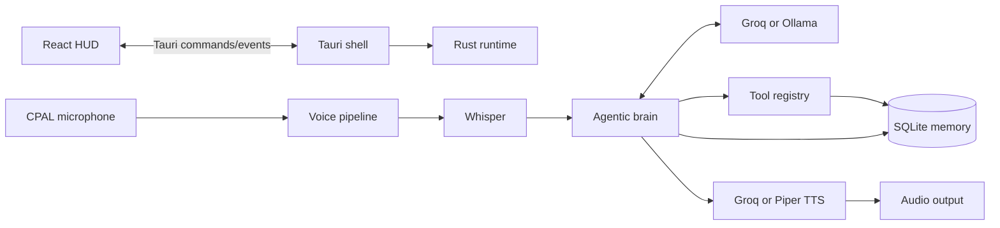
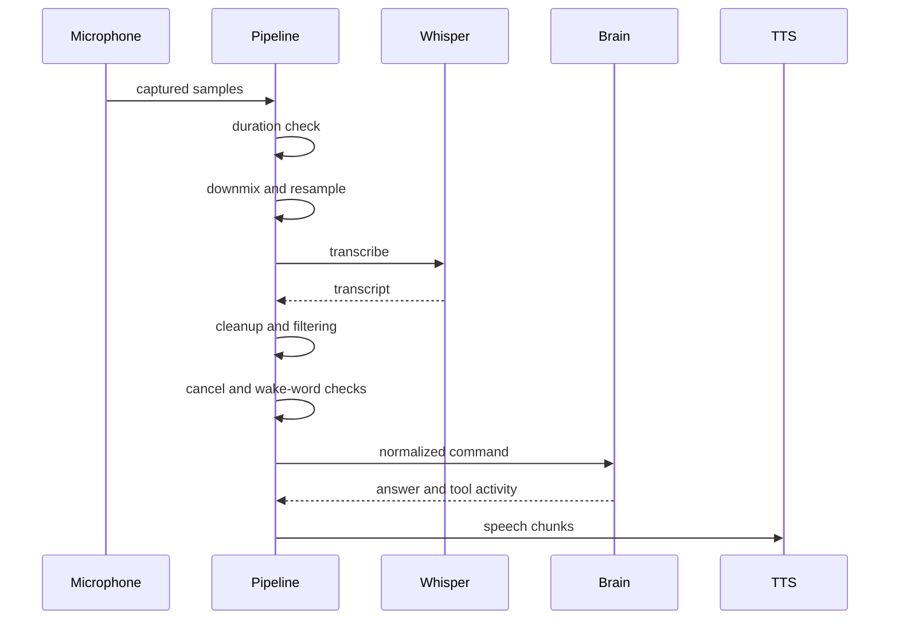
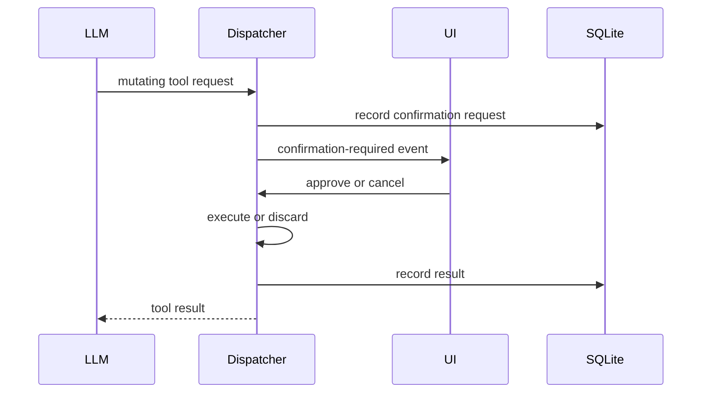

# Karen Desktop Assistant: Current Architecture

## 1. Purpose

Karen is a Tauri desktop assistant built around a Rust runtime, a React/Vite HUD, Whisper speech recognition, configurable LLM providers, configurable TTS providers, SQLite memory, and a guarded desktop tool system.

The intended interaction loop is:

1. Tino speaks to Karen.
2. Karen captures microphone audio.
3. Whisper converts speech to text.
4. The brain adds persona, desktop context, conversation history, memories, and tools.
5. The selected LLM answers directly or requests tools.
6. Mutating tools request confirmation.
7. Karen streams the answer into TTS.
8. The UI shows the current state and conversation.
9. Microphone capture resumes after speech.

Karen is designed for normal conversation, architecture discussions, development assistance, and controlled computer operation.

## 2. Repository layout

```text
Karen/
├── Persona.md                         # Runtime persona prompt
├── .env                               # Local secrets and runtime overrides
├── README.md
└── karen-desktop/
    ├── package.json                   # Frontend scripts and dependencies
    ├── src/
    │   ├── App.tsx                    # Main HUD and Tauri event client
    │   ├── App.css
    │   ├── index.css
    │   └── main.tsx
    └── src-tauri/
        ├── Cargo.toml
        └── src/
            ├── main.rs                # Native entry point
            ├── lib.rs                 # Tauri setup, state, commands, shortcuts
            ├── audio.rs               # CPAL microphone capture
            ├── resample.rs            # Channel conversion and resampling
            ├── stt.rs                 # Whisper model loading and transcription
            ├── pipeline.rs            # Audio-to-brain orchestration
            ├── config.rs              # Typed voice configuration
            ├── context_engine.rs      # Current desktop context
            ├── brain/
            │   ├── mod.rs             # LLM requests, streaming, agent loop
            │   ├── tools.rs           # Tool registry, risk policy, dispatcher
            │   ├── tools/system.rs    # System and desktop controls
            │   ├── tools/memory.rs    # Memory-related tool handlers
            │   ├── open_app.rs        # Application launching
            │   ├── browse_files.rs    # Directory and file operations
            │   └── devlogs.rs         # Development log tools
            ├── tts/
            │   ├── mod.rs             # TTS queue, cancellation, generations
            │   ├── manager.rs         # Provider selection and fallback
            │   ├── provider.rs        # Provider interface
            │   ├── groq.rs            # Groq cloud TTS
            │   └── piper.rs           # Local Piper TTS
            └── memory/
                ├── mod.rs             # MemoryEngine state
                ├── database.rs        # SQLite schema and migrations
                ├── conversations.rs   # Conversation and message storage
                ├── memories.rs        # Notes, FTS, semantic recall
                ├── semantic.rs        # Embedding and vector ranking
                ├── events.rs          # Activity and tool event records
                └── temporal.rs        # Relative time formatting
```

## 3. Process architecture

Karen has one native Tauri process containing the Rust backend. During development, Vite runs as a separate frontend server.



### Single-instance protection

At startup `lib.rs` creates:

```text
$XDG_DATA_HOME/karen-assistant/karen.lock
```

The file contains Karen’s PID and is held for the lifetime of the process. A second live process exits. If the stored PID no longer exists, the lock is considered stale and is recovered.

This prevents duplicate:

- Microphone capture
- Startup greetings
- TTS playback
- Global shortcut handlers
- Agent processing

### Tray behavior

The native shell creates a tray menu with:

- Show Karen
- Quit Karen

Quit cancels active TTS before exiting.

## 4. Startup sequence

1. Load `.env` with `dotenvy`.
2. Acquire the single-instance lock.
3. Initialize logging.
4. Create the SQLite database.
5. Create the context engine.
6. Initialize audio capture and shared audio state.
7. Create the Whisper state holder.
8. Register Tauri commands.
9. Register global shortcuts.
10. Create the tray menu.
11. Start microphone listening.
12. Start the startup greeting task.
13. Ask the brain for a short in-character greeting.
14. Speak the greeting.
15. Resume listening after playback.

Karen reads `Persona.md` on every brain request. Persona changes therefore take effect without restarting the application.

## 5. Voice input lifecycle

### 5.1 Microphone capture

`audio.rs` uses CPAL and supports:

- Native `f32`
- Signed `i16`
- Unsigned `u16`

Samples are normalized to `f32` in the range `[-1.0, 1.0]`. Multi-channel input is downmixed to mono before Whisper processing.

The capture worker receives:

```rust
AudioCommand::Start
AudioCommand::Stop
```

The audio buffer holds samples until a stop event marks one utterance ready for the pipeline.

### 5.2 Capture settling

Karen waits approximately 450 ms before starting capture after TTS playback. This reduces microphone feedback from the tail of Karen’s own voice.

### 5.3 Input controls

Input can be controlled through:

- Clicking the central HUD core
- `toggle_mic_command`
- `Ctrl+Space`
- `Ctrl+Alt+M` push-to-talk

Push-to-talk starts capture on key press and processes the utterance on key release.

### 5.4 Barge-in

The wake path calls `tts::cancel()` before starting a new capture. TTS cancellation increments the current generation immediately, invalidating older LLM and TTS work.

Karen recognizes:

```text
cancel
stop
stop talking
be quiet
never mind
nevermind
```

A cancel phrase skips the LLM and returns Karen to listening.

## 6. Speech-to-text pipeline



### Duration guard

Utterances shorter than 0.3 seconds are ignored.

### Resampling

Whisper receives mono 16 kHz audio:

1. Channel downmixing
2. Linear resampling to 16 kHz

### Whisper model loading

Whisper loads lazily on first use. The default model is:

```text
ggml-tiny.en.bin
```

Without an override, the model is downloaded to the application data directory. An absolute local model can be selected with:

```env
KAREN_WHISPER_MODEL_PATH=/absolute/path/to/model.bin
```

### Transcript cleanup

Karen rejects:

- Empty transcripts
- Bracketed and parenthesized silence markers
- `[BLANK_AUDIO]`
- `[SILENCE]`
- Common Whisper background-audio completions
- Common subscription-outro hallucinations

Whitespace is normalized while short valid commands such as `stop`, `yes`, and `open` remain valid.

## 7. Wake-word system

Wake-word mode is optional:

```env
KAREN_WAKE_WORD_ENABLED=true
KAREN_WAKE_WORD=karen
```

The typed `VoiceConfig` in `config.rs` is the central reader for these settings.

Supported forms include:

```text
Karen, open the browser
Hey Karen, open the browser
Okay Karen, open the browser
Hello Karen
```

Default-name Whisper variants include:

```text
karen
karin
caren
karrin
karren
```

If Karen hears only the wake phrase, the pipeline emits a follow-up state and keeps the microphone armed for the next utterance. The next command does not need to repeat the wake word.

## 8. Brain and agentic execution

The brain is implemented in `brain/mod.rs`.

### Providers

| Provider | Purpose | Default |
|---|---|---|
| Groq | Cloud LLM and optional cloud TTS | `openai/gpt-oss-120b` |
| Ollama | Local or LAN-hosted LLM | `qwen2.5:3b` |

Current Ollama endpoint:

```text
http://10.50.101.11:11434/v1/chat/completions
```

Known chat models:

```text
qwen2.5:3b
qwen2.5-coder:7b
```

### Agent loop

Each request includes:

- Persona
- Current date
- Desktop context
- Relevant memories
- Recent activity events
- Recent conversation messages
- Registered tool definitions

The agent loop permits up to five iterations. A model may:

1. Return text.
2. Request tools.
3. Receive tool results.
4. Continue reasoning.
5. Produce a final answer.

### Streaming

OpenAI-compatible streaming responses are parsed incrementally. Text is accumulated into utterance chunks and sent to the TTS manager before the full answer is complete.

A generation ID is carried through LLM and TTS work. A new wake or cancellation invalidates older work.

## 9. Persona and conversation

Persona path:

```env
KAREN_PERSONA_PATH=/home/shadowe/Projects/Karen/Persona.md
```

If unavailable, Karen uses a minimal fallback persona.

Conversation messages are stored in SQLite. The latest messages are included in each prompt.

Context limits:

- 10 messages by default
- Configurable from 2 to 40
- Maximum 4,000 characters per recalled message

Configuration:

```env
KAREN_CONTEXT_MESSAGES=12
```

Oversized messages are truncated with:

```text
… [earlier detail compacted]
```

This is bounded compaction, not yet model-generated summarization.

## 10. Tool architecture

Tools are registered in `brain/tools.rs` and dispatched through the agentic interface.

Feature modules include:

- `open_app.rs`
- `browse_files.rs`
- `devlogs.rs`
- `tools/system.rs`
- `tools/memory.rs`

### Current tools

#### Applications

- `open_app`

#### Web and desktop

- `open_url`
- `take_screenshot`
- `set_volume`
- `press_key`
- `type_text`

#### System inspection

- `get_system_info`
- `list_processes`
- `get_current_time`

`list_processes` uses `ps`, sorts by CPU usage, and returns the top 20 processes.

#### Files and development

- `list_directory`
- `read_file`
- `list_dev_logs`
- `read_dev_logs`

#### Memory and activity

- `save_memory`
- `search_events`

### Risk policy

Each tool is classified as:

```rust
ToolRisk::AutoRun
ToolRisk::ConfirmRequired
```

Read-only operations and safe URL opening can run automatically. Desktop mutations such as opening applications, typing, pressing keys, and changing volume require confirmation.

Risk is added to tool definitions as `x-risk`.

### Confirmation flow



One pending confirmation is held in an in-memory mutex at a time.

### Audit trail

Tool executions are recorded in SQLite `events` with:

- Tool name
- JSON arguments
- Success or failure
- Duration
- Truncated result preview

Confirmation requests are recorded as `tool_confirmation_requested`.

## 11. Text-to-speech

TTS uses a provider interface and manager.

### Groq

Uses:

```env
GROQ_API_KEY=...
GROQ_TTS_MODEL=...
GROQ_TTS_VOICE=...
```

### Piper

Runs locally:

```env
PIPER_MODEL_PATH=/absolute/path/to/voice.onnx
```

### Provider policy

```text
auto    Groq first, Piper fallback
groq    Groq first, Piper fallback
piper   Piper first, Groq fallback
```

Runtime setting:

```env
KAREN_TTS_PROVIDER=auto
```

TTS cancellation is generation-based and synchronous at the control boundary, which prevents a new request from racing with old speech.

## 12. Memory architecture

Karen uses bundled SQLite through `rusqlite`.

### Tables

```text
conversations
messages
memories
memories_fts
tasks
events
```

### Conversations

Conversation records include identifiers and timestamps. Messages include:

- ID
- Conversation ID
- Role
- Content
- Recorded time

Recent messages are queried in reverse time order and reversed before use so prompts remain chronological.

### Explicit memories

Memories contain:

- ID
- Content
- Optional source ID
- Optional serialized embedding
- Recorded time
- Updated time

When Ollama is selected, `save_memory` attempts to create an embedding.

### Full-text search

SQLite FTS5 indexes memory content. Search input is sanitized into a bounded OR query.

### Semantic search

`memory/semantic.rs` supports:

- Ollama `/api/embeddings`
- Configurable embedding model
- Cosine similarity
- Candidate ranking

Configuration:

```env
KAREN_OLLAMA_EMBED_MODEL=nomic-embed-text
```

The current VM has not yet installed `nomic-embed-text`, so Karen falls back to FTS search when embeddings are unavailable.

Install it on the VM with:

```bash
ollama pull nomic-embed-text
```

### Activity events

Tool executions and recent activity are stored in `events` and included in brain context.

## 13. Desktop context

`context_engine.rs` maintains a lightweight desktop view. The brain can receive:

- Current inferred activity
- Top active processes
- Recent system events
- Relevant memories

This helps the model decide when a tool is needed.

## 14. React HUD

The main UI is currently in `src/App.tsx`.

### UI state

The HUD tracks:

- Orb state
- Microphone state
- Current status text
- TTS provider
- LLM provider and model
- Pending confirmation
- Mission log
- Latest command
- Latest response

### Tauri event channels

#### `wake-karen`

Returns the HUD to listening mode.

#### `toggle-mic`

Synchronizes microphone state.

#### `push-to-talk`

Carries `{ active: boolean }`.

#### `karen-pipeline`

Stages include:

```text
model-missing
transcribing
thinking
running-tool
confirmation-required
speaking
answer
error
idle
wake-followup
listening
```

### Visual design

The HUD is a JARVIS-inspired mission-control layout with:

- Dark blue and cyan palette
- Arc-reactor voice core
- Rotating rings
- Subsystem status
- Mission log
- Live dialogue panel
- Voice activity bars
- TTS and LLM controls
- Microphone and status quick controls
- Confirmation controls

The design is implemented in Karen’s React code and does not directly depend on the reference JARVIS frontend.

## 15. Tauri commands

| Command | Purpose |
|---|---|
| `toggle_mic_command` | Toggle microphone capture |
| `set_tts_provider` | Select `auto`, `groq`, or `piper` |
| `set_llm_provider` | Select `groq` or `ollama` and model |
| `check_ollama` | Check Ollama and list models |
| `confirm_pending_tool` | Approve pending mutation |
| `cancel_pending_tool` | Reject pending mutation |

## 16. Global shortcuts

| Shortcut | Behavior |
|---|---|
| `Ctrl+Space` | Wake Karen, cancel speech, start listening |
| `Ctrl+Alt+M` press | Start push-to-talk |
| `Ctrl+Alt+M` release | Stop capture and process |

## 17. Configuration reference

### LLM

```env
KAREN_LLM_PROVIDER=groq
KAREN_OLLAMA_URL=http://10.50.101.11:11434/v1/chat/completions
KAREN_OLLAMA_MODEL=qwen2.5:3b
GROQ_API_KEY=...
GROQ_MODEL=openai/gpt-oss-120b
```

### Voice

```env
KAREN_WAKE_WORD_ENABLED=false
KAREN_WAKE_WORD=karen
KAREN_CONTEXT_MESSAGES=10
KAREN_SPEECH_END_SILENCE_MS=350
KAREN_PROACTIVE_MODE=false
KAREN_PROACTIVE_INTERVAL_MINUTES=30
KAREN_PROACTIVE_QUIET_START=22
KAREN_PROACTIVE_QUIET_END=7
```

### Whisper

```env
KAREN_WHISPER_MODEL=ggml-tiny.en.bin
KAREN_WHISPER_MODEL_PATH=/absolute/path/to/model.bin
```

### TTS

```env
KAREN_TTS_PROVIDER=auto
KAREN_VOICE_PROFILE=fast
GROQ_TTS_MODEL=...
GROQ_TTS_VOICE=...
PIPER_MODEL_PATH=/absolute/path/to/model.onnx
```

### Persona and logs

```env
KAREN_PERSONA_PATH=/home/shadowe/Projects/Karen/Persona.md
KAREN_DEVLOG_ROOT=/path/to/devlog/root
```

Never commit `.env` or API keys.

## 18. Development commands

From `karen-desktop`:

```bash
npm install
npm run dev -- --host 127.0.0.1
npm run build
```

From `karen-desktop/src-tauri`:

```bash
cargo test pipeline::tests
cargo test brain::tools::tests
cargo test memory::semantic::tests
cargo test config::tests
```

During development, Vite and the native backend may need to run separately if the Tauri watcher reaches the system file-watch limit.

## 19. Test coverage

### Audio

- Float clamping
- Signed PCM conversion
- Unsigned PCM conversion
- Capture settling delay

### Resampling

- Channel downmixing
- Identity resampling
- Downsample length and range

### Voice pipeline

- Whisper non-speech markers
- Real speech classification
- Wake-word extraction
- Wake-word aliases
- Follow-up wake behavior
- Transcript cleanup
- Hallucination rejection
- Barge-in cancellation

### Tools

- Unique tool names
- Risk metadata
- Unsafe URL rejection
- Desktop argument validation
- Confirmation classification

### Memory

- FTS query construction
- Cosine similarity
- Semantic ranking

### Frontend

```bash
npm run build
```

The frontend build currently passes.

## 20. Known limitations

1. Wake-word detection is transcript-based, not a low-power always-on keyword detector.
2. Follow-up listening has no configurable timeout yet.
3. Semantic memory requires `nomic-embed-text`; FTS fallback is active without it.
4. Vision currently stops at screenshot capture; multimodal image analysis is not wired into the brain.
5. Browser automation is not implemented.
6. Desktop control is limited to the allowlisted tools.
7. Older system helper definitions remain in `tools.rs` after routing live calls through `tools/system.rs`; they should be removed in cleanup.
8. Context compaction truncates oversized messages rather than generating a model-produced summary.
9. Only one pending confirmation request can exist at once.
10. The React HUD is concentrated in `App.tsx) and can later be split into components.
11. Runtime provider settings are process-wide and mutable; some external environment changes require restart.

## 21. Recommended next work

1. Add a configurable follow-up timeout and explicit conversation mode.
2. Add multimodal screenshot analysis.
3. Add visible browser automation with confirmation.
4. Split the HUD into components:
   - `Core`
   - `SubsystemPanel`
   - `MissionLog`
   - `DialoguePanel`
   - `SettingsDock`
5. Remove duplicate system helper implementations.
6. Replace truncation-only compaction with a durable summary.
7. Add integration tests for startup greeting, wake, cancellation, confirmations, and TTS fallback.
8. Add a persistent Tino profile for preferences and frequently used applications.

## 22. End-to-end example

For:

```text
Hey Karen, open the browser and tell me what is running on my system.
```

The flow is:

1. CPAL captures the utterance.
2. The pipeline converts audio to mono 16 kHz.
3. Whisper returns the transcript.
4. Cleanup normalizes the transcript.
5. Wake extraction removes `Hey Karen`.
6. The brain loads persona and desktop context.
7. The LLM selects `open_app` and `list_processes`.
8. `open_app` requests confirmation.
9. The HUD shows the confirmation control.
10. Tino approves.
11. Karen launches the browser.
12. Karen runs `list_processes` automatically.
13. Tool events are written to SQLite.
14. The LLM receives the results.
15. The streamed answer is split into TTS chunks.
16. Karen speaks the response.
17. Microphone capture resumes.

This is the current foundation for Karen as a conversational and voice-operated desktop assistant.

