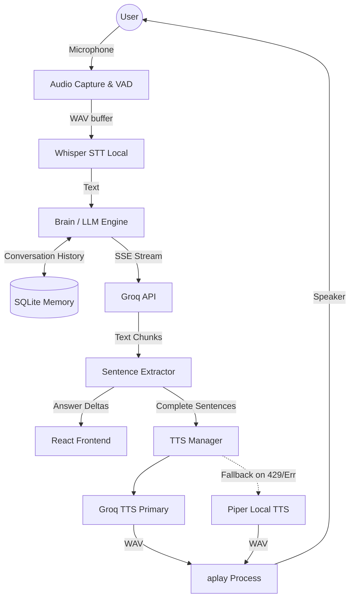

# Karen Architecture

## Overview
Karen is a localized AI desktop assistant composed of a Rust/Tauri backend for performance-intensive audio/file processing and a React/Vite frontend for the user interface. It is architected for asynchronous streaming, minimizing End-of-Speech to First-Audible-Response (TTFT) latency while maintaining local-first privacy where possible.

## System Diagram

## Components

### 1. Audio Capture & STT (`src/stt.rs`)
- **Responsibility:** Captures microphone input, applies Voice Activity Detection (VAD) to find endpoints, and transcribes audio to text.
- **Tech:** Uses local Whisper inference (`tiny.en` by default).

### 2. The Brain (`src/brain/mod.rs`)
- **Responsibility:** Orchestrates the LLM prompt, context retrieval, memory logging, and tool execution.
- **Tech:** Groq API with Server-Sent Events (SSE). Extracts full sentences continuously for the TTS engine.

### 3. TTS Manager (`src/tts/mod.rs`)
- **Responsibility:** Synthesizes audio from text sentences with minimal latency. It manages a provider contract for fault tolerance.
- **Providers:** `GroqProvider` (Primary), `PiperProvider` (Fallback).
- **Concurrency & State:** Uses an `AtomicUsize` global counter (`current_generation`) to synchronize cancellations between the frontend, the LLM streaming loop, and active audio playback. If a user interrupts, the generation ID increments, causing any stale processing to abort.

### 4. Memory (`src/memory/mod.rs`)
- **Responsibility:** Maintains short-term episodic memory to provide contextual continuity between user turns.
- **Tech:** Embedded SQLite database.

## Data Flow (A Typical Turn)
1. **Listen:** The VAD detects speech and passes the WAV to Whisper.
2. **Think:** Whisper's text output is given to the `run_agentic` pipeline. The backend queries SQLite for recent memories.
3. **Stream:** The LLM responds via SSE. As tokens arrive, they are forwarded to the React UI instantly.
4. **Chunk:** When a full sentence punctuation mark is reached, the sentence is dispatched to the TTS Manager.
5. **Speak:** The TTS Manager requests audio synthesis from Groq (or Piper). As soon as the WAV is generated, it plays via `aplay`. If the user speaks again, `cancel()` increments `current_generation`, terminating the LLM loop and killing the `aplay` child process.

## Key Design Decisions
- **Local Fallback TTS:** Groq TTS API limits often cause 429s. Piper provides an offline fallback to ensure the system is always responsive. (See ADR-0001)
- **Decoupled Text/Audio UI:** TTS synthesis runs asynchronously. The text UI update is independent of audio success so that the user can still read the response if audio fails entirely.
- **Generation Tracking for Cancellation:** Instead of complex thread-messaging, a simple atomic generation counter allows any async loop to quickly check if it has been interrupted by the user.

## Constraints and Non-Goals
- **No System-wide God Privileges:** The assistant operates within the strict permissions of the user space and executes specific tools deterministically, rather than giving the LLM an unconstrained shell.
